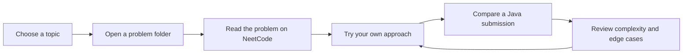

<div align="center">

# NeetCode Solutions — Java

**A browsable archive of my NeetCode.io problem-solving practice.**

[](https://github.com/Harshalj2003/neetcode-submissions-o5yzzd5l/search?l=java)
[](https://github.com/Harshalj2003/neetcode-submissions-o5yzzd5l/tree/main/Data%20Structures%20%26%20Algorithms)
[](https://neetcode.io/)

[Browse solutions](#-quick-problem-finder) · [Understand the folders](#-how-to-use-this-repo) · [Practice on NeetCode](https://neetcode.io/)

</div>

---

## 👋 About

This repository keeps my Java submissions for NeetCode and data-structure-and-algorithm practice. Problems are grouped into individual folders, making it easy to browse a topic, open a problem, and compare the saved submissions for it.

> **Learning archive:** These are practice solutions, not a single prescribed or universally optimal answer. Read the problem statement and think through an approach before opening a solution.

## 🧭 Quick problem finder

Choose a topic to expand its problem links. Each link opens that problem's folder in this repository.

<details>
<summary><strong>Arrays & hashing</strong></summary>

- [Anagram Groups](<Data Structures & Algorithms/anagram-groups>)
- [Duplicate Integer](<Data Structures & Algorithms/duplicate-integer>)
- [Is Anagram](<Data Structures & Algorithms/is-anagram>)
- [Longest Consecutive Sequence](<Data Structures & Algorithms/longest-consecutive-sequence>)
- [Majority Element](<Data Structures & Algorithms/majority-element>)
- [Products of Array Discluding Self](<Data Structures & Algorithms/products-of-array-discluding-self>)
- [Two Integer Sum](<Data Structures & Algorithms/two-integer-sum>)
- [Valid Sudoku](<Data Structures & Algorithms/valid-sudoku>)

</details>

<details>
<summary><strong>Two pointers & sliding window</strong></summary>

- [Max Water Container](<Data Structures & Algorithms/max-water-container>)
- [Minimum Window with Characters](<Data Structures & Algorithms/minimum-window-with-characters>)
- [Longest Substring without Duplicates](<Data Structures & Algorithms/longest-substring-without-duplicates>)
- [Longest Repeating Substring with Replacement](<Data Structures & Algorithms/longest-repeating-substring-with-replacement>)
- [Permutation String](<Data Structures & Algorithms/permutation-string>)
- [Trapping Rain Water](<Data Structures & Algorithms/trapping-rain-water>)
- [Three Integer Sum](<Data Structures & Algorithms/three-integer-sum>)
- [Two Integer Sum II](<Data Structures & Algorithms/two-integer-sum-ii>)

</details>

<details>
<summary><strong>Stacks & queues</strong></summary>

- [Daily Temperatures](<Data Structures & Algorithms/daily-temperatures>)
- [Design Circular Queue](<Data Structures & Algorithms/design-circular-queue>)
- [Evaluate Reverse Polish Notation](<Data Structures & Algorithms/evaluate-reverse-polish-notation>)
- [Minimum Stack](<Data Structures & Algorithms/minimum-stack>)
- [Validate Parentheses](<Data Structures & Algorithms/validate-parentheses>)

</details>

<details>
<summary><strong>Binary search</strong></summary>

- [Binary Search](<Data Structures & Algorithms/binary-search>)
- [Eating Bananas](<Data Structures & Algorithms/eating-bananas>)
- [Find Minimum in Rotated Sorted Array](<Data Structures & Algorithms/find-minimum-in-rotated-sorted-array>)
- [Find Target in Rotated Sorted Array](<Data Structures & Algorithms/find-target-in-rotated-sorted-array>)
- [Search 2D Matrix](<Data Structures & Algorithms/search-2d-matrix>)

</details>

<details>
<summary><strong>Linked lists</strong></summary>

- [Copy Linked List with Random Pointer](<Data Structures & Algorithms/copy-linked-list-with-random-pointer>)
- [Linked List Cycle Detection](<Data Structures & Algorithms/linked-list-cycle-detection>)
- [Merge Two Sorted Linked Lists](<Data Structures & Algorithms/merge-two-sorted-linked-lists>)
- [Remove Node from End of Linked List](<Data Structures & Algorithms/remove-node-from-end-of-linked-list>)
- [Reorder Linked List](<Data Structures & Algorithms/reorder-linked-list>)
- [Reverse a Linked List](<Data Structures & Algorithms/reverse-a-linked-list>)

</details>

<details>
<summary><strong>Trees & binary search trees</strong></summary>

- [Balanced Binary Tree](<Data Structures & Algorithms/balanced-binary-tree>)
- [Binary Tree Diameter](<Data Structures & Algorithms/binary-tree-diameter>)
- [Binary Tree Inorder Traversal](<Data Structures & Algorithms/binary-tree-inorder-traversal>)
- [Binary Tree from Preorder and Inorder Traversal](<Data Structures & Algorithms/binary-tree-from-preorder-and-inorder-traversal>)
- [Binary Tree Right Side View](<Data Structures & Algorithms/binary-tree-right-side-view>)
- [Count Good Nodes in Binary Tree](<Data Structures & Algorithms/count-good-nodes-in-binary-tree>)
- [Invert a Binary Tree](<Data Structures & Algorithms/invert-a-binary-tree>)
- [Kth Smallest Integer in BST](<Data Structures & Algorithms/kth-smallest-integer-in-bst>)
- [Level Order Traversal of Binary Tree](<Data Structures & Algorithms/level-order-traversal-of-binary-tree>)
- [Lowest Common Ancestor in BST](<Data Structures & Algorithms/lowest-common-ancestor-in-binary-search-tree>)
- [Same Binary Tree](<Data Structures & Algorithms/same-binary-tree>)
- [Valid Binary Search Tree](<Data Structures & Algorithms/valid-binary-search-tree>)

</details>

<details>
<summary><strong>Heaps & priority queues</strong></summary>

- [K Closest Points to Origin](<Data Structures & Algorithms/k-closest-points-to-origin>)
- [Kth Largest Element in an Array](<Data Structures & Algorithms/kth-largest-element-in-an-array>)
- [Kth Largest Integer in a Stream](<Data Structures & Algorithms/kth-largest-integer-in-a-stream>)
- [Last Stone Weight](<Data Structures & Algorithms/last-stone-weight>)
- [Top K Elements in List](<Data Structures & Algorithms/top-k-elements-in-list>)

</details>

<details>
<summary><strong>Backtracking & tries</strong></summary>

- [Combination Target Sum](<Data Structures & Algorithms/combination-target-sum>)
- [Combination Target Sum II](<Data Structures & Algorithms/combination-target-sum-ii>)
- [Combinations of a Phone Number](<Data Structures & Algorithms/combinations-of-a-phone-number>)
- [Generate Parentheses](<Data Structures & Algorithms/generate-parentheses>)
- [Implement Prefix Tree](<Data Structures & Algorithms/implement-prefix-tree>)
- [Palindrome Partitioning](<Data Structures & Algorithms/palindrome-partitioning>)
- [Permutations](<Data Structures & Algorithms/permutations>)
- [Subsets](<Data Structures & Algorithms/subsets>) · [Subsets II](<Data Structures & Algorithms/subsets-ii>)
- [Search for Word](<Data Structures & Algorithms/search-for-word>)

</details>

<details>
<summary><strong>Design & other data structures</strong></summary>

- [Design HashSet](<Data Structures & Algorithms/design-hashset>)
- [Design Twitter Feed](<Data Structures & Algorithms/design-twitter-feed>)
- [LRU Cache](<Data Structures & Algorithms/lru-cache>)
- [Time-Based Key-Value Store](<Data Structures & Algorithms/time-based-key-value-store>)

</details>

<details>
<summary><strong>Browse every problem folder</strong></summary>

[Open the full Data Structures & Algorithms directory →](https://github.com/Harshalj2003/neetcode-submissions-o5yzzd5l/tree/main/Data%20Structures%20%26%20Algorithms)

</details>

## 🗂️ How to use this repo

```text
Data Structures & Algorithms/
└── <problem-name>/
    ├── submission-0.java
    ├── submission-1.java
    └── ...
```

- **One folder per problem:** problem folders sit inside `Data Structures & Algorithms/`.
- **Java throughout:** submissions use the `.java` extension.
- **Numbered submissions:** the folder may contain multiple saved submissions. Open the problem folder and choose a file to inspect; the numbering is the saved-file order, not a claim that each file is a different algorithm.

### A quick route through a solution



## 🔎 Finding a solution

1. Expand a topic above, or [browse all problem folders](https://github.com/Harshalj2003/neetcode-submissions-o5yzzd5l/tree/main/Data%20Structures%20%26%20Algorithms).
2. Open the matching problem folder.
3. Select a `submission-*.java` file to view the code.
4. Use the [repository search](https://github.com/Harshalj2003/neetcode-submissions-o5yzzd5l/search?q=submission-&type=code) if you know a class name or code pattern.

## 🔄 Sync & practice

This repository is connected to NeetCode's GitHub integration. To manage or learn about syncing submissions, visit [NeetCode GitHub settings](https://neetcode.io/profile/github). For problem statements and guided practice, visit [NeetCode](https://neetcode.io/).

---

<div align="center">

Made while practicing, one problem at a time. ☕ · [Back to top](#neetcode-solutions--java)

</div>
